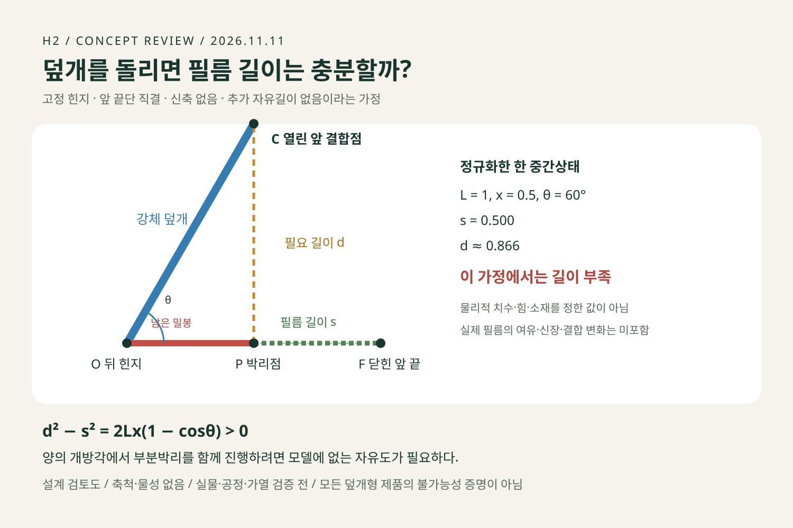

# H2 후속 검토 — 개봉 편의와 덮개 연동의 경계

기준일 2026-11-11. 기존 이미지·120규칙·검사 기록을 보존하는 후속 설계 판단이다. 실물 제작·시식·공정·개봉력·가열·사용자 시험은 실행하지 않았다.

## 이번 결정
개발 비교 기준은 **H2-A: 넓은 일체형 탭과 박리 시작부를 함께 개선하는 필름형**으로 좁힌다. 사용자가 원하는 **H2-B: 열고 다시 덮는 외뚜껑**은 계속 후보로 보존한다. 다만 단순한 고정 힌지와 필름 끝단 직결만으로 순차 개봉이 된다는 설명은 채택하지 않는다. A는 재닫기를 제공하지 않으므로 사용자의 전체 요구를 해결한 제품으로 부르지 않는다.

A를 우선하는 이유는 검증해야 할 변수가 상대적으로 적기 때문이다. 원가가 실제로 낮다거나 개봉력이 개선됐다는 판정은 아니다. 공모전의 창의성 평가에서도 A가 기존 이지필 포장과 충분히 다른지는 별도 과제다. 이 검토만으로 기존 A 「갓 지은 편지」·B 「스물네 장의 계절」 출품 이미지를 교체하지 않는다.

## 단순 덮개 구조의 기하 반례

폭을 생략한 이상화한 단면이다. 제품의 치수·재질·힘을 정한 모델이 아니다.

- 뒤 힌지 O=(0,0), 앞쪽 결합점의 닫힌 위치 F=(L,0), L>0.
- 강체 덮개가 각도 θ만큼 열리면 앞 결합점 C=(L cosθ, L sinθ).
- 앞에서 뒤로 벗겨지는 필름의 현재 박리점 P=(x,0), 0<x<L.
- 필름은 늘어나지 않고 추가 자유길이가 없으며, 앞 끝단만 C에 고정된다고 가정한다.
- 벗겨진 필름 길이 s=L−x. P와 C를 잇는 최소 길이 d=√(L²+x²−2Lx cosθ).

따라서 **d²−s²=2Lx(1−cosθ)>0** (0<θ≤π)다. 즉 양의 개방각에서 이 모델의 부분박리 상태는 필름 길이가 부족하다. 단순히 필름을 구부리거나 접는 것으로 직선거리보다 짧게 이을 수는 없다.

정확한 결론은 **회전과 부분박리가 함께 진행되는 중간상태가 이 모델에서 성립하지 않는다**는 것이다. θ=0에서 먼저 전부 박리한 후 회전하는 형식적 경로까지 식이 배제하는 것은 아니다. 마지막 접착점이 남는 극한 x→0에서는 등호가 성립한다. 완전히 떨어진 뒤에는 P에 구속되지 않는다.

실제 앞 탭의 여유길이, 미끄러지는 결합, 결합 위치, 힌지 이동, 재질 신장·덮개 변형은 가정을 바꾼다. 따라서 **덮개형 제품 전체가 불가능하다는 증명이 아니다.** 자유길이만 추가해도 작동한다고 단정하지 않는다. 각 상태에서 적어도 d−s를 충족할 길이와 적절한 당김 방향을 함께 검토해야 한다.

별도 AI 검토에서 수식을 대조했고, “연속 경로 전체 불가능”이라는 과도한 해석을 위 문장으로 수정했다. 정규화 L=1의 1,000개 중간상태 수치 검산은 대수 관계를 확인할 뿐, 필름의 실제 거동을 시뮬레이션하거나 실물 시험을 대신하지 않는다.

## 병목과 다음 결정 조건

|항목|A에서 확인할 것|B에서 추가로 해결할 것|
|---|---|---|
|잡기|밀봉 밖 넓은 탭의 접근·젖은 손·좌우손|잠금부와 손잡이의 접근, 용기 지지|
|힘·파단|시작/진행/끝의 박리 저항, 탭·층간 파손|힌지 궤적·필름 자유길이·결합부·후단 박리|
|가열 전 준비|필요한 부분개봉과 멈춤 위치|조금 열고 덮거나 다시 열 때 필름 장력·환기 경로|
|취식·응축수|마지막 이탈의 튐과 물 흐름|부착막 수납, 물이 손·잠금부로 흐르는지|
|재닫기|기능 없음|젖은 막이 테두리·밥·잠금부에 끼지 않는지|
|유통·제조|최초 밀봉·장벽·공정 후 개봉|덮개 성형·정렬·결합·검사, 유통 중 오개봉|
|경제성·폐기|변경 비용·수율·추가 재료와 구매 이유|A 대비 실제 추가 이득, 부품·결합재 분리|

밀봉 자체를 임의로 약하게 하거나 장벽을 관통하는 절취선을 전제로 삼지 않는다. 제조/시험 전문가가 대상 사용자와 제품 요구를 정하고 합격선을 시험 전에 설정해야 한다. 이 문서는 가열법·보관법을 제공하지 않는다.

**B 재개 조건:** 앞/중간/후단의 필름 경로를 도면에서 닫힌 상태→부분개봉→완전개봉으로 연결한다. 그 뒤 식품 없는 목업과 힘 측정, 공정 후 밀봉·가열·실제 사용성을 검증한다. 필름 재집기나 추가 분해가 필요하면 목표인 덮개 연동 개봉은 실패다. 재닫기의 구매 이득이 A 대비 추가 비용과 조작을 정당화해야 한다.

## 공모전 표현을 위한 3컷 지시

1. **잡기:** 밀봉 영역 밖의 넓은 탭을 확대한다. 다른 손은 용기를 지지한다.
2. **벗기기 시작:** 같은 용기의 탭과 밀봉 경계를 구분하고 당김 방향을 보여준다.
3. **끝까지 개봉하는 목표:** 같은 구조의 필름이 분리된 사용 장면을 제시한다.

표기는 “개봉 구조 제안 — 실물·공정·가열 검증 전”. 큰 손잡이를 한손 개봉·힘 감소·밀봉 유지의 증거로 표현하지 않는다. 이번 산출물은 구조 검토도이며 새로운 출품 사진 완성본은 아니다.

근거 범위: [이전 구조 검토](../product_review_2026-11-04/H2_개봉구조_설계검토.md), [상품성 재판정](../product_review_2026-11-04/상품성_재판정.md), 이번 대수 반례·독립 AI 반론. 기존 문서에 있는 공급사 자료가 제안 구조의 작동성을 입증하는 것으로 확대하지 않았다.
